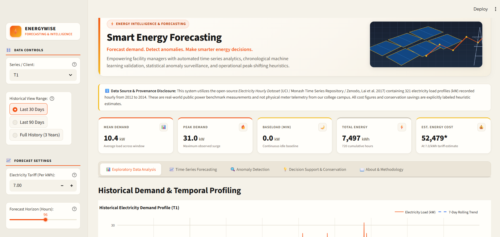
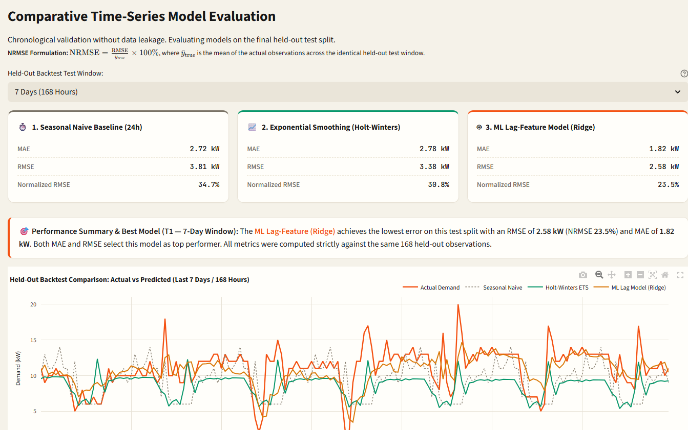
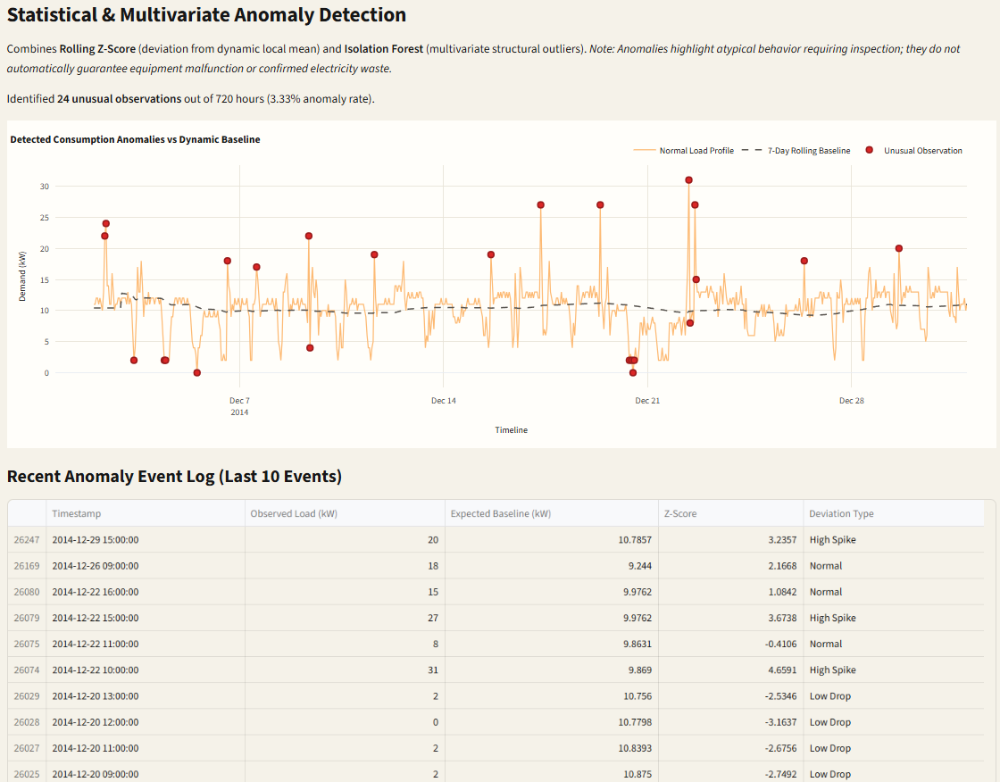
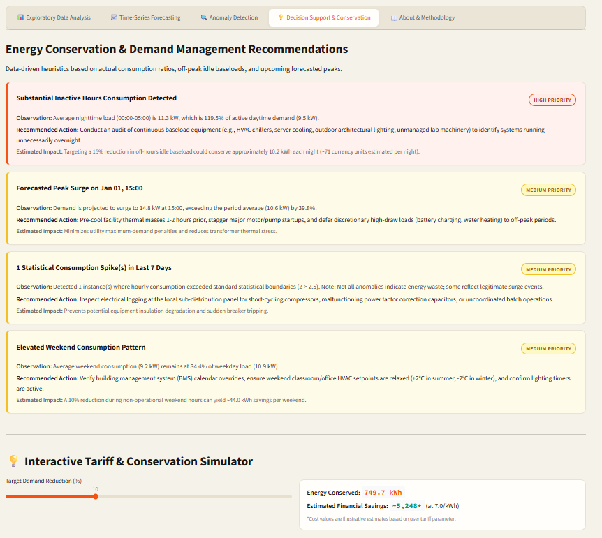

# Smart Energy Forecasting and Conservation Decision Support System

A time-series analytics and decision-support application for exploring electricity consumption, forecasting future demand, detecting unusual consumption patterns, and generating energy-conservation recommendations.

## Overview

The **Smart Energy Forecasting and Conservation Decision Support System** is a Semester 7 Computer Engineering mini-project developed as part of Time Series Data Analytics (TSDA).

The application uses historical hourly electricity-consumption data to demonstrate how time-series analysis and machine learning can support energy monitoring and conservation planning.

It provides an interactive Streamlit dashboard with exploratory data analysis, forecasting, anomaly detection, and rule-based conservation recommendations.

> **Dataset note:** The project uses a public electricity-consumption benchmark dataset. Its results are not measurements of actual SPIT campus electricity consumption.

## Key Features

- **Exploratory Data Analysis (EDA):** Examine historical consumption trends, daily patterns, distributions, and day-of-week/hourly behavior.
- **Time-Series Forecasting:** Compare Seasonal Naive, Holt-Winters Exponential Smoothing, and Ridge Regression models.
- **Configurable Forecast Horizon:** Evaluate forecasts over 7-day, 14-day, and 28-day horizons.
- **Forecast Evaluation:** Compare models using Mean Absolute Error (MAE), Root Mean Squared Error (RMSE), and Normalized RMSE (NRMSE).
- **Anomaly Detection:** Identify unusual consumption observations using rolling Z-scores and Isolation Forest.
- **Conservation Decision Support:** Generate rule-based suggestions based on consumption patterns and forecasted demand.
- **Tariff-Based Cost Estimation:** Estimate energy costs using a configurable electricity tariff.
- **Interactive Dashboard:** Explore the data and analytical results through a Streamlit interface.


## Screenshots

The following screenshots showcase the application's main analytical modules.

### 1. Exploratory Data Analysis



### 2. Time-Series Forecasting



### 3. Anomaly Detection



### 4. Decision Support and Conservation



## Technology Stack

| Component | Technologies |
|---|---|
| Programming language | Python |
| Data processing | Pandas, NumPy |
| Machine learning | Scikit-learn |
| Statistical forecasting | Statsmodels |
| Visualization | Plotly |
| Dashboard | Streamlit |
| Testing | Python unittest |

## Project Structure

```text
smart-energy-forecasting/
├── app.py
├── requirements.txt
├── README.md
├── src/
│   ├── data_loader.py
│   ├── eda.py
│   ├── forecasting.py
│   ├── anomaly.py
│   └── recommender.py
├── tests/
│   ├── test_data_loader.py
│   └── test_analytics.py
└── assets/
    └── energy_banner.png
```

*The structure above represents the expected organization; adjust it to match the files actually present in the repository.*

## Dataset

The project uses the public **Electricity Hourly Dataset** in Time Series Forecasting (TSF) format.

- Source: [Zenodo — Record 4656140](https://zenodo.org/records/4656140)
- Dataset file: `electricity_hourly_dataset.tsf`
- Reported dataset dimensions: 321 time series, each containing 26,304 hourly observations.
- Reported time span: 2012–2014.

The dataset loader parses the TSF file and makes the selected series available for analysis.

**Important:** The dataset is intended for benchmark analysis and demonstration. The project does not claim access to real-time electricity meters or institution-specific energy data.

### Dataset setup

Download the dataset from the source above and place it in the location expected by `src/data_loader.py`.

Check the loader configuration before running the application, and update the dataset path if necessary.

## Installation and Setup

### 1. Clone the repository

```bash
git clone <YOUR_GITHUB_REPOSITORY_URL>
cd smart-energy-forecasting
```

Replace the placeholder with your actual repository URL.

### 2. Create a virtual environment

Windows:

```powershell
python -m venv .venv
.venv\Scripts\Activate.ps1
```

If PowerShell blocks activation, you can use Command Prompt:

```bat
.venv\Scripts\activate.bat
```

### 3. Install dependencies

```bash
python -m pip install --upgrade pip
pip install -r requirements.txt
```

### 4. Configure the dataset

Download `electricity_hourly_dataset.tsf` and place it in the configured data directory.

### 5. Run the application

```bash
python -m streamlit run app.py
```

Open the local URL displayed in the terminal, usually:

`http://localhost:8501`

## Application Modules

### 1. Exploratory Data Analysis

The EDA module provides:

- Historical consumption timeline
- Hour-of-day consumption profile
- Consumption distribution visualization
- Day-of-week and hour heatmap
- Summary statistics

### 2. Time-Series Forecasting

The forecasting module compares three approaches:

- **Seasonal Naive:** Uses historical values from the corresponding seasonal period as a baseline.
- **Holt-Winters Exponential Smoothing:** Models level, trend, and seasonality.
- **Ridge Regression:** Uses lag-based features to predict future consumption.

Model evaluation uses a chronological hold-out period to preserve the time order of observations.

The reported metrics are:

- **MAE:** Average absolute difference between actual and predicted values.
- **RMSE:** Square root of the average squared prediction error.
- **NRMSE:** RMSE normalized by the mean of the actual hold-out observations, expressed as a percentage.

The application also provides an operational forecast ensemble combining Holt-Winters and Seasonal Naive forecasts. The operational ensemble is distinct from selecting the best-performing individual model during backtesting.

### 3. Anomaly Detection

The anomaly module uses:

- Rolling Z-score analysis to identify deviations from recent consumption behavior.
- Isolation Forest to flag potentially unusual observations.

Anomalies are indicators for further investigation. They do not automatically establish equipment failure, energy theft, or a confirmed fault.

### 4. Conservation Decision Support

The recommendation module applies heuristic rules to consumption and forecast patterns to suggest actions such as:

- Reviewing overnight consumption
- Investigating unusual demand spikes
- Shifting flexible loads away from forecast peak periods
- Reviewing weekend energy-use patterns

The recommendations are intended as decision-support suggestions, not guaranteed energy-saving measures.

### 5. Tariff-Based Cost Estimation

The application estimates electricity cost using:

`Estimated Cost = Estimated Energy Consumption (kWh) × Tariff (₹/kWh)`

For hourly average power observations measured in kW, summing the hourly readings gives the corresponding energy in kWh, assuming each observation represents one hour.

The estimate uses a configurable flat tariff and may not capture demand charges, time-of-use pricing, taxes, or other billing components.

## Forecasting Results

The following are the reported backtesting results for series T4. Verify them against the final code and dataset before treating them as final experimental results.

### 7-day forecast horizon

| Model | MAE | RMSE | NRMSE |
|---|---:|---:|---:|
| Seasonal Naive | 67.12 | 91.91 | 15.64% |
| Holt-Winters | 59.75 | 82.48 | 14.03% |
| Ridge Regression | 43.36 | 55.50 | 9.44% |

### 14-day forecast horizon

| Model | MAE | RMSE | NRMSE |
|---|---:|---:|---:|
| Seasonal Naive | 78.83 | 102.43 | 17.37% |
| Holt-Winters | 147.34 | 176.37 | 29.90% |
| Ridge Regression | 42.20 | 55.30 | 9.38% |

### 28-day forecast horizon

| Model | MAE | RMSE | NRMSE |
|---|---:|---:|---:|
| Seasonal Naive | 75.38 | 101.69 | 17.64% |
| Holt-Winters | 75.44 | 91.30 | 15.83% |
| Ridge Regression | 40.72 | 54.08 | 9.38% |

These results indicate that Ridge Regression achieved the lowest reported error among the three individual models for the evaluated T4 horizons. Performance may differ for other series and forecasting periods.

The confidence band shown by the application is a heuristic volatility-based band; it should not be interpreted as a statistically calibrated 95% prediction interval.

## Testing

The project includes unit tests for data loading and analytical functionality.

Run the tests from the project root:

```bash
python -m unittest discover tests
```

The development environment has reported 14 passing tests. Re-run the command against the final repository to confirm the current test status.

## Limitations

- The dataset is historical and does not provide live meter readings.
- The benchmark series may not represent the consumption behavior of a particular campus or building.
- Forecast accuracy can vary across time series and horizons.
- Anomaly detection can produce false positives and requires contextual investigation.
- Conservation recommendations are rule-based and have not been demonstrated to produce guaranteed savings.
- Flat-tariff cost estimates are illustrative rather than official billing calculations.

## Future Scope

Potential improvements include:

- Integration with actual smart-meter or IoT data
- Additional forecasting models and automated model selection
- Rolling-origin cross-validation and broader model comparisons
- Calibrated prediction intervals
- Weather, occupancy, and calendar information as explanatory features
- More detailed tariff and demand-charge modeling
- Evaluation of recommendations using measured energy savings
- Deployment to a cloud-hosted dashboard

## Academic Context

**Project:** Smart Energy Forecasting and Conservation Decision Support System  
**Course:** Time Series Data Analytics (TSDA)  
**Semester:** Semester 7  
**Department:** Computer Engineering  
**Institution:** Sardar Patel Institute of Technology

## Contributors

- Haniya Javed Akhtar Shaikh
- Rutuja Jagdish Kokane

## License

No license has been specified yet. Add an appropriate open-source license if you intend to permit public reuse, modification, or distribution of this project.

## Acknowledgements

The project uses a publicly available electricity time-series benchmark dataset and open-source Python libraries for data analysis, forecasting, machine learning, visualization, and dashboard development.
